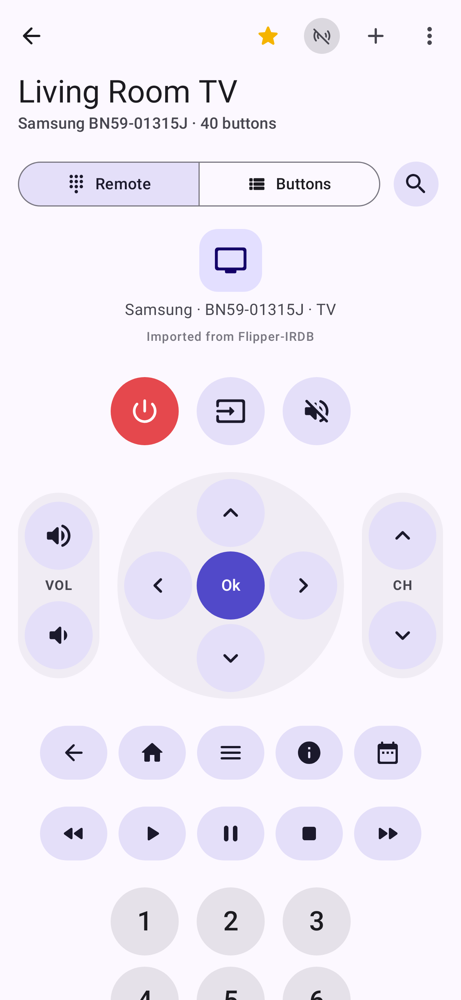
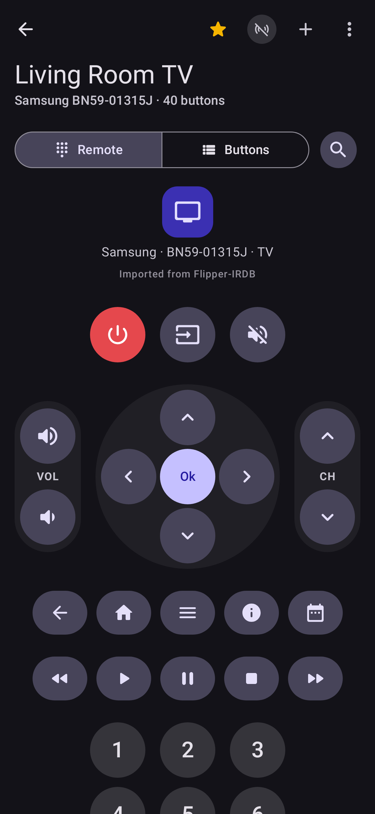
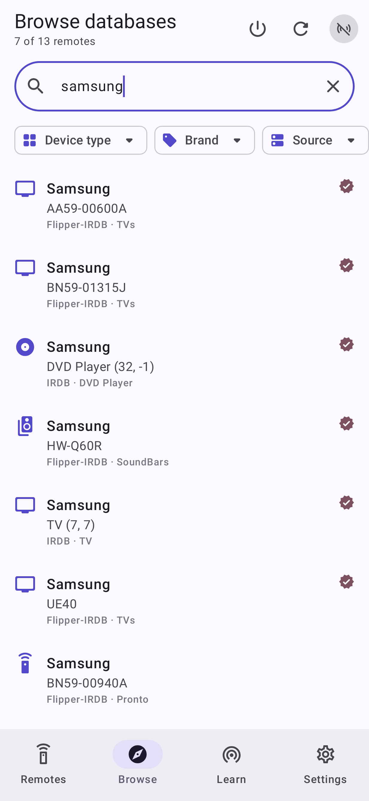
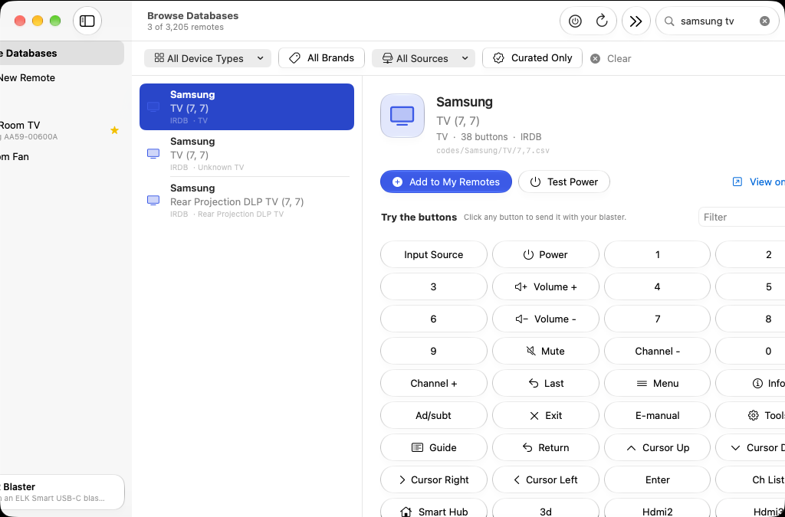
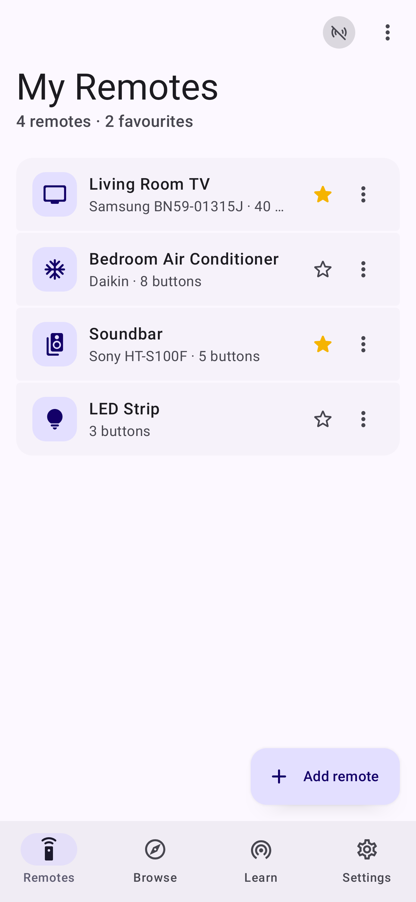
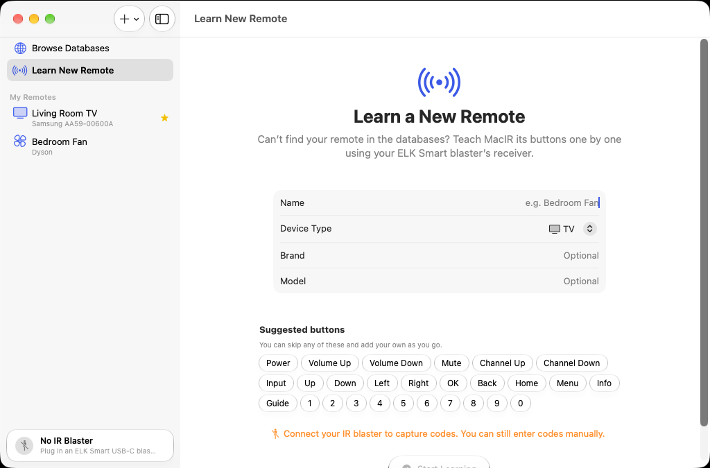
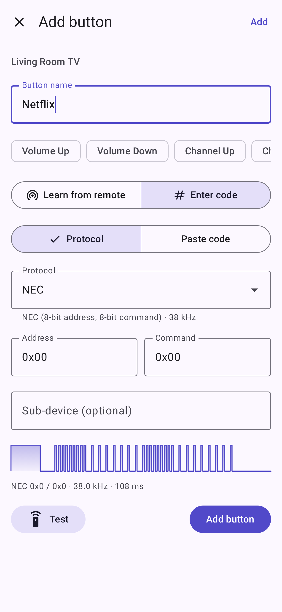
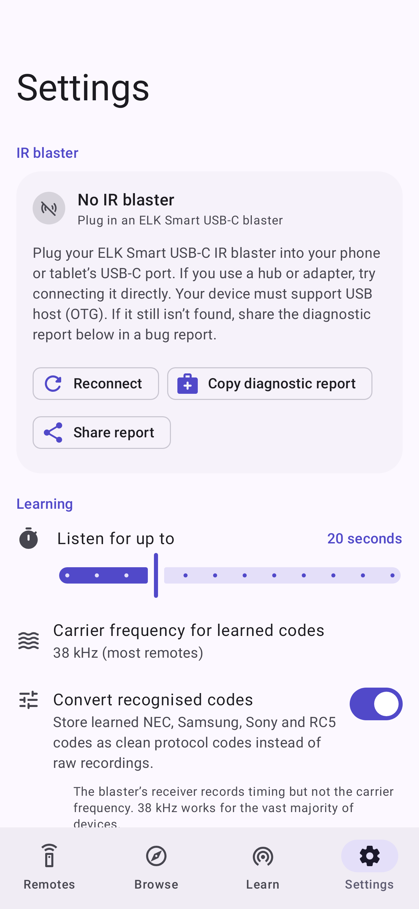
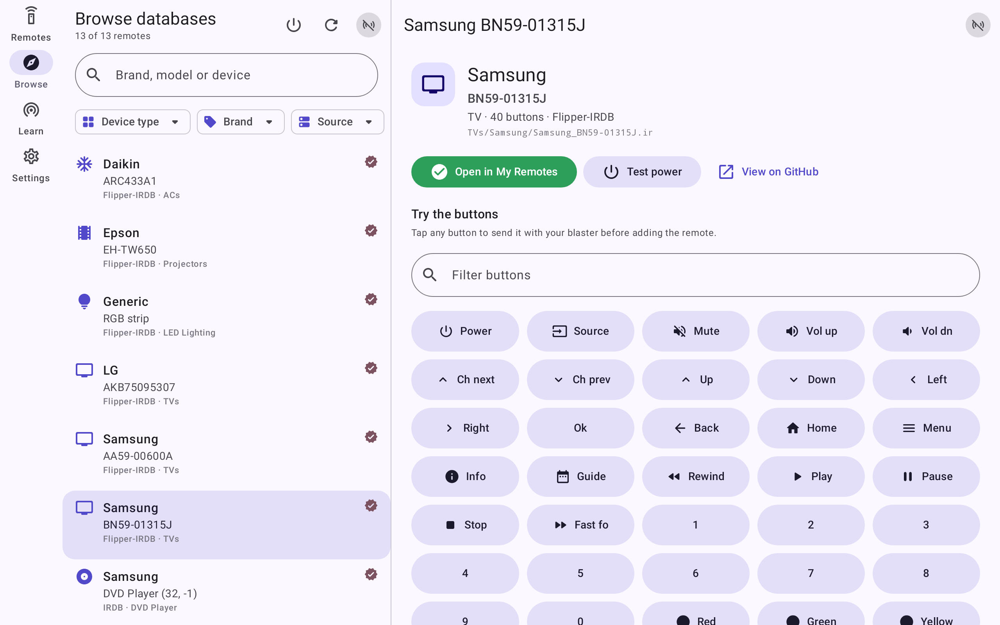

# IR Controller for Android

> This is the **`android`** branch of [IR Controller](https://github.com/thecaticorn01/IR-Controller): it holds only the Android app. The project overview, downloads and the build/release workflows live on the [`main`](https://github.com/thecaticorn01/IR-Controller/tree/main) branch; the macOS app lives on [`macos`](https://github.com/thecaticorn01/IR-Controller/tree/macos).

A native Android app that turns an **ELK Smart USB-C IR blaster** into a universal remote for your phone or tablet.
Search thousands of remotes online, try them before importing, learn the ones that aren't in any database, and control everything from a Material 3 Expressive interface, a home-screen widget, pinned shortcuts or automation apps.

| Remote | Remote (dark) | Database search | Preview & try |
|---|---|---|---|
|  |  |  |  |
| **My Remotes** | **Learn a new remote** | **Enter a code** | **Settings** |
|  |  |  |  |

On tablets and foldables the library and the database browser switch to a list-detail layout with a navigation rail:



<sub>The screenshots are rendered from the real app by the Robolectric screenshot tests (`./gradlew test`), so CI regenerates them.</sub>

## Features

**Online remote databases, built in**
- Search and filter remotes from [Flipper-IRDB](https://github.com/Lucaslhm/Flipper-IRDB) and [IRDB](https://github.com/probonopd/irdb) without leaving the app. Nothing has to be downloaded by hand: indexes and remote files are fetched in the app.
- Search-as-you-type ranks brand and model matches first, and finds model numbers typed without dashes (e.g. `aa5900600a`).
- Filter by device type and brand (both with match counts, plus a searchable brand list), by source, or to hand-curated files only.
- Preview any remote and **try its buttons with your blaster before adding it**, with one tap to add it to your library.
- **Power Scan** steps through the matching remotes and sends each one's power code until your device responds, either manually or automatically every few seconds.
- Add any other public GitHub repository of Flipper `.ir` or IRDB `.csv` files as an extra source. Indexes are cached and refreshed every few days. An optional GitHub token, encrypted with an Android Keystore key, raises the API rate limit. The app also falls back to the jsDelivr mirror.

**Learn new remotes**
- A guided wizard suggests the usual buttons for the device type. Point your remote at the blaster and press each button; skip, add, remove or redo buttons as you go.
- Shows each captured waveform and detects NEC, NECext, NEC42, Samsung32, Sony SIRC 12/15/20 and RC5. Detected codes can be stored as clean protocol codes.
- Add or re-learn single buttons on any remote, or enter codes by hand: protocol + address/command, Pronto hex, Global Caché `sendir`, or raw timings.

**Sending**
- A physical-remote layout with a power row, volume and channel rockers around a D-pad, navigation and transport rows, number pad, colour keys and climate controls. Every other button goes into a "More buttons" grid. A list view lets you rename, reorder, edit and delete buttons.
- Haptic feedback, and buttons that squeeze when pressed.
- Your phone's **volume keys** can control the remote's volume. A hardware keyboard works too: arrows, Enter, Space, `+`/`−`, `M`, `P`, `[`/`]` and digits.
- Long-press any button to send it as a long press, copy its Pronto hex, **pin it to the home screen** (it sends without opening the app), edit it or delete it.
- The **Quick Remote** home-screen widget shows your favourite remote's key buttons and can cycle through your favourites. Long-press the app icon for shortcuts to your favourite remotes.
- **Automation**: when enabled in Settings, apps such as Tasker can press buttons with a broadcast:
  `am broadcast -a com.thecaticorn01.ircontroller.action.PRESS_BUTTON -n com.thecaticorn01.ircontroller/.system.AutomationReceiver --es remote "Living Room TV" --es button "Power"`
- 26 protocol encoders: every Flipper Zero protocol (NEC, NECext, NEC42, NEC42ext, Samsung32, RC5, RC5X, RC6, SIRC, SIRC15, SIRC20, Kaseikyo, RCA, Pioneer) plus the common IRP protocols IRDB uses (NEC1/2, NECx, NEC1-f16, Sony12/15/20, JVC, Panasonic, Denon, Sharp, Mitsubishi, Aiwa, MCE/RC6-6-32, RCA 38/58 kHz). RC5/RC6 toggle bits alternate correctly between presses, and you can add extra repeats.

**Library**
- Favourites, duplicate, rename, reorder, edit details and notes.
- Import `.ir`, `.csv` and `.json` files with the file picker, or open or share them into the app from any other app.
- Export any remote as a Flipper Zero `.ir` file, share it, or back up the whole library as `.json` to restore later or on another device.

**Design**
- Material 3 Expressive with dynamic colour (Material You), light and dark themes, and an adaptive, themed launcher icon.
- Adaptive navigation: a bottom bar on phones, a navigation rail and list-detail panes on tablets and foldables.
- Edge-to-edge and predictive back.

## Download

Get `IR-Controller-<version>-android.apk` from [**GitHub Releases**](https://github.com/thecaticorn01/IR-Controller/releases/latest), open it on your phone or tablet, and allow your browser or file manager to install unknown apps when Android asks.

## Requirements

- Android 8.0 (API 26) or later; built for and targeting **Android 17 (API 37)**.
- A phone or tablet with USB host (USB OTG) support. Nearly all USB-C devices have it.
- An ELK Smart USB IR blaster (USB vendor `0x045C`). Known product IDs: EKX5S-T `0x0184` (the international USB-C model), EKX4S `0x0195`, EKX5S `0x0134`, plus `0x0131`, `0x0132`, `0x014A`, `0x02AA`.

When you plug the blaster in, Android offers to open IR Controller. Tick **Always open** to grant USB access permanently. Otherwise the app asks for access the first time it connects.

## Building

```sh
./gradlew assembleDebug            # app/build/outputs/apk/debug/app-debug.apk
./gradlew assembleRelease          # minified with R8; signed with the debug key unless a release key is configured
./gradlew test                     # protocol/codec/database tests + UI screenshot tests (writes app/screenshots/)
./gradlew lint
LIVE_NETWORK_TESTS=1 ./gradlew :core:test   # also checks downloads from the real databases
```

You need JDK 17+ and the Android SDK with `platforms;android-37.0` and `build-tools;37.0.0` (set `sdk.dir` in `local.properties` or `ANDROID_HOME`). Open the repository in Android Studio to work on the app.

Version and signing for release builds come from outside the code: `-PversionName=1.2.3 -PversionCode=…` set the version, and the `ANDROID_KEYSTORE_FILE`, `ANDROID_KEYSTORE_PASSWORD`, `ANDROID_KEY_ALIAS` and (optional) `ANDROID_KEY_PASSWORD` environment variables select a release key. Without them the release APK is signed with the debug key.

CI and releases are defined on the `main` branch. Its workflows check out this branch, then test, lint and build it, and publish the APK in the same GitHub release as the other platforms.

## Project layout

```
core/                     Pure Kotlin/JVM library with no Android dependencies (unit tested)
  model/                  IRRemote, IRButton, IRSignal, button roles, keypad layout, learning templates
  protocols/              PulseBuilder, 26 protocol encoders, decoder for learned codes
  formats/                Flipper .ir reader/writer, IRDB CSV, Pronto / sendir import
  elksmart/               ElkSmart wire protocol (codec + driver over a BulkTransport)
  database/               GitHub/jsDelivr index fetching, indexing, ranked faceted search
  library/                Library JSON format
app/                      The Android app (Kotlin, Jetpack Compose, Material 3 Expressive)
  blaster/                USB discovery, permission, bulk transport, BlasterManager (I/O on one thread)
  data/                   Library, databases, settings (DataStore) and the Keystore-backed secret store
  system/                 Launcher shortcuts, pinned button shortcuts, automation receiver, key routing
  widget/                 Quick Remote home-screen widget (Glance)
  ui/                     Navigation, library, remote keypad, database browser, learning wizard, settings
```

The ElkSmart encoder is checked byte-for-byte against vectors from the reference C implementation. The app's own tests drive the real UI with Robolectric and save the screenshots above.

## How the blaster works

The dongle exposes one USB interface with a bulk OUT and a bulk IN endpoint. The app finds that interface and claims it with `UsbDeviceConnection.claimInterface(…, force = true)`, which detaches any kernel driver that bound to its communications-class interface, so no root or driver is needed. The wire protocol was reverse-engineered by Přemysl Eric Janouch in [`elksmart-comm`](https://git.janouch.name/p/usb-drivers) (0BSD licence); this app is an independent Kotlin implementation:

| Command | Bytes | Purpose |
|---|---|---|
| Identify | `FC FC FC FC` | Reply `FC×4 70 01` / `FA×4 …` = plain payloads; `FC×4 02 AA` = Huffman-coded payloads (EKX5S-T) |
| Transmit | `FF FF FF FF` + mangled frequency + length + payload | Payload = pulse list with the two most common (mark, space) pairs dictionary-coded; split into 62-byte packets plus a checksum byte |
| Learn | `FE FE FE FE` | The dongle replies `FE×4 <len16>` followed by durations in 16 µs units |
| Stop | `FD FD FD FD` | Ends learning |

## Troubleshooting

- **"No IR blaster"**: plug the dongle straight into the USB-C port; some dongles are picky about hubs and adapters. Your device must support USB OTG.
- **"Allow USB access"**: tap the blaster status icon, then **Allow access**, and accept the system dialog.
- **Anything else**: tap the blaster status icon (top right) → **Share report**, and include the report in an issue. It lists the USB devices the app sees, their interfaces and endpoints, and the activity log.
- **Learning times out**: hold the remote about 1 cm from the end of the dongle and try again. The dongle doesn't measure carrier frequency; 38 kHz (configurable in Settings) suits nearly all devices.
- **A code works only sometimes**: raise *Extra repeats per press* in Settings.
- **Database won't load**: GitHub's anonymous API allows 60 requests an hour. The app falls back to jsDelivr, and you can add a GitHub token in Settings → Remote databases.

## Credits

- Remote data is downloaded at runtime from [Flipper-IRDB](https://github.com/Lucaslhm/Flipper-IRDB) and [IRDB](https://github.com/probonopd/irdb). See those projects for their licences. No database content is bundled with the app.
- ElkSmart protocol documentation: [elksmart-comm](https://git.janouch.name/p/usb-drivers) by Přemysl Eric Janouch.
- Protocol timings follow the Flipper Zero firmware conventions and the IRP notation used by IrScrutinizer/IRDB.
