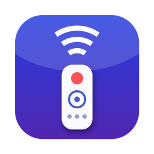
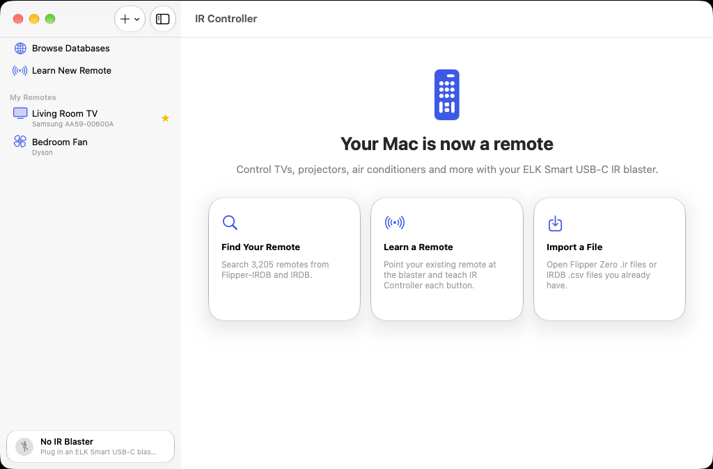

# IR Controller for macOS

> This is the **`macos`** branch of [IR Controller](https://github.com/thecaticorn01/IR-Controller): it holds only the macOS app. The project overview, downloads and the build/release workflows live on the [`main`](https://github.com/thecaticorn01/IR-Controller/tree/main) branch; the Android app lives on [`android`](https://github.com/thecaticorn01/IR-Controller/tree/android).

A native macOS app that turns an **ELK Smart USB-C IR blaster** into a universal remote for your Mac.
Search thousands of remotes online, try them before importing, learn the ones that aren't in any database, and control everything from a Liquid Glass interface, the menu bar, your keyboard, or Shortcuts.



| Remote | Database preview |
|---|---|
|  |  |
| **Learn a new remote** | **Welcome** |
|  |  |

<sub>Screenshots are captured automatically by CI on macOS 27 (Xcode 27).</sub>

## Features

**Online remote databases, built in**
- Search and filter remotes from [Flipper-IRDB](https://github.com/Lucaslhm/Flipper-IRDB) (~8,900 files) and [IRDB](https://github.com/probonopd/irdb) (~3,200 device codesets) without leaving the app.
- Search-as-you-type ranks brand and model matches first, and finds model numbers even when you type them without dashes (e.g. `aa5900600a`).
- Filter by device type, brand (with a searchable brand list and counts), source, or hand-curated files only.
- Preview any remote and **try its buttons with your blaster before importing**. Add it to your library with one click.
- **Power Scan**: steps through the matching remotes and sends each one's power code until your device responds. Useful when you don't know the model.
- Add any other public GitHub repository of Flipper `.ir` or IRDB `.csv` files as an extra source (for example a Flipper-IRDB fork). Indexes are cached and refreshed automatically.

**Learn new remotes**
- A guided wizard suggests the usual buttons for the device type (TV, AC, soundbar…). Point your remote at the blaster and press each button.
- Shows each captured waveform and detects NEC, NECext, NEC42, Samsung32, Sony SIRC 12/15/20 and RC5. Detected codes can be stored as clean protocol codes instead of noisy recordings.
- Add or re-learn single buttons on any remote, or enter codes by hand: protocol + address/command, Pronto hex, Global Caché `sendir`, or raw timings.

**Sending**
- Physical-remote layout: power row, volume and channel rockers around a D-pad, transport controls, number pad, colour keys and climate controls. Anything else goes into a "More Buttons" grid.
- Keyboard control: arrows, Return, Space, `+`/`−`, `M`, `P`, `[`/`]` and digits.
- A menu bar remote for favourites, a **Press Remote Button** action for Shortcuts, and RC5/RC6 toggle bits that alternate correctly between presses.
- 26 protocol encoders: every Flipper Zero protocol (NEC, NECext, NEC42, NEC42ext, Samsung32, RC5, RC5X, RC6, SIRC, SIRC15, SIRC20, Kaseikyo, RCA, Pioneer) plus the common IRP protocols IRDB uses (NEC1/2, NECx, NEC1-f16, Sony12/15/20, JVC, Panasonic, Denon, Sharp, Mitsubishi, Aiwa, MCE/RC6-6-32, RCA 38/58 kHz).

**Library**
- Favourites, duplicate, rename, reorder and edit buttons. Import by drag-and-drop or ⌘O (`.ir`, `.csv`, `.json`), and export any remote as a Flipper Zero `.ir` file.

## Download

Get the latest build from [**GitHub Releases**](https://github.com/thecaticorn01/IR-Controller/releases/latest): `IR-Controller-<version>-macos.dmg` (or `.zip`). It's a universal app (Apple silicon and Intel) for macOS 26 or later.

Release builds are signed ad hoc but not notarized, so macOS asks for confirmation the first time: open **System Settings → Privacy & Security** and click **Open Anyway**, or run `xattr -dr com.apple.quarantine "/Applications/IR Controller.app"`.

Releases are built by the workflows on the `main` branch, which check out this branch, build it, and publish one release containing every platform's app.

## Requirements

- macOS 26 (Tahoe) or later. Built for the latest SDK, including macOS 27 "Golden Gate".
- Xcode 26 or later to build.
- An ELK Smart USB IR blaster (USB vendor `0x045C`). Known product IDs: EKX5S-T `0x0184` (the international USB-C model), EKX4S `0x0195`, EKX5S `0x0134`, plus `0x0131`, `0x0132`, `0x014A`, `0x02AA`.

## Building

```sh
git clone --branch macos https://github.com/thecaticorn01/IR-Controller.git IR-Controller-macos
cd IR-Controller-macos
open IRController.xcodeproj
```

Choose the **IRController** scheme and run (⌘R). To run on your own Mac, set your development team under *Signing & Capabilities*, or keep the default ad-hoc "Sign to Run Locally" identity.

Command-line build and tests:

```sh
xcodebuild -project IRController.xcodeproj -scheme IRController -configuration Release build
swift test --package-path IRCore      # protocol, format, ElkSmart and search tests (also runs on Linux)
```

CI is defined on the `main` branch: it builds this branch with Xcode 26 (macOS 26 SDK) and Xcode 27 (macOS 27 SDK), runs the `IRCore` tests on macOS and Linux, and launches the app to capture the screenshots above.

## Project layout

```
IRCore/                     Swift package with no UI dependencies (Swift 6, unit tested)
  Model/                    IRRemote, IRButton, IRSignal, button roles, keypad layout
  Protocols/                PulseBuilder, 26 protocol encoders, decoder for learned codes
  Formats/                  Flipper .ir reader/writer, IRDB CSV, Pronto / sendir import
  ElkSmart/                 ElkSmart wire protocol (codec + driver over a BulkTransport)
  Database/                 GitHub/jsDelivr index fetching, indexing, ranked faceted search
IRController/               The macOS app (SwiftUI, Liquid Glass)
  USB/                      IOUSBHost device monitor and bulk pipes (Objective-C) + Swift adapter
  Stores/                   LibraryStore, DatabaseStore, BlasterManager (USB I/O on a serial queue)
  Views/                    Sidebar, remote keypad, database browser, learning wizard, settings
  Intents/                  App Intents for Shortcuts
```

## How the blaster works

ELK Smart dongles (sold under ELK Smart / Ocrustar / ZaZa Remote) show up as a single vendor-specific USB interface (class `0xFF`) with one bulk OUT and one bulk IN endpoint. IR Controller talks to them directly from user space with Apple's **IOUSBHost** framework. No driver or kernel extension is needed.

IR Controller deliberately runs **without the App Sandbox** but with the hardened runtime. Recent macOS releases deny sandboxed apps the `iokit-open-service IOUSBHostInterface` operation, even when they have the USB entitlement, so a sandboxed build can see the dongle but can't open it.

Some dongle revisions report a communications-class (CDC) interface instead, and macOS may attach its own serial driver to those. In that case IR Controller uses the serial port the driver publishes (`/dev/cu.*`), which carries the same bulk endpoints (entitlement `com.apple.security.device.serial`). As a last resort it tries to capture the device from the driver, which only works with elevated privileges. Settings → IR Blaster shows which transport is in use.

The wire protocol was reverse-engineered by Přemysl Eric Janouch in [`elksmart-comm`](https://git.janouch.name/p/usb-drivers) (0BSD licence). IR Controller is an independent Swift implementation of that protocol, and its unit tests check the output byte-for-byte against the reference C implementation:

| Command | Bytes | Purpose |
|---|---|---|
| Identify | `FC FC FC FC` | Reply `FC×4 70 01` / `FA×4 …` = plain payloads; `FC×4 02 AA` = Huffman-coded payloads (EKX5S-T) |
| Transmit | `FF FF FF FF` + mangled frequency + length + payload | Payload = pulse list with the two most common (mark, space) pairs dictionary-coded; split into 62-byte packets plus a checksum byte |
| Learn | `FE FE FE FE` | The dongle replies `FE×4 <len16>` followed by durations in 16 µs units |
| Stop | `FD FD FD FD` | Ends learning |

## Troubleshooting

- **"No IR Blaster"**: plug the dongle straight into a USB-C port. Some dongles are picky about hubs and adapters.
- **"The IR blaster is in use by another program"**: the message names the process (pid and name). Quit it, then reconnect the dongle.
- **Anything else**: click the blaster status at the bottom of the sidebar → **Copy Diagnostic Report**, and include the report in an issue. It lists the USB devices IR Controller sees, the macOS driver tree below the dongle, and which process owns any open connection to it.
- **Learning times out**: hold the remote about 1 cm from the end of the dongle. The EKX4S's receiver is known to be temperamental, so retrying usually helps. The dongle doesn't measure carrier frequency; 38 kHz (configurable in Settings) suits nearly all devices.
- **A code works only sometimes**: raise *Extra repeats per press* in Settings → General.
- **Database won't load**: GitHub's anonymous API allows 60 requests an hour. IR Controller falls back to jsDelivr, and you can add a GitHub token in Settings → Databases.

## Upgrading from MacIR

Pre-release builds of this app were called **MacIR**. On first launch, IR Controller copies over your remotes, settings and GitHub token from MacIR. If macOS asks whether IR Controller may access data from other apps, click **Allow**: that's MacIR's old sandboxed library. You can then delete MacIR.

## Credits

- Remote data is downloaded at runtime from [Flipper-IRDB](https://github.com/Lucaslhm/Flipper-IRDB) and [IRDB](https://github.com/probonopd/irdb). See those projects for their licences. No database content is bundled with the app.
- ElkSmart protocol documentation: [elksmart-comm](https://git.janouch.name/p/usb-drivers) by Přemysl Eric Janouch.
- Protocol timings follow the Flipper Zero firmware conventions and the IRP notation used by IrScrutinizer/IRDB.
